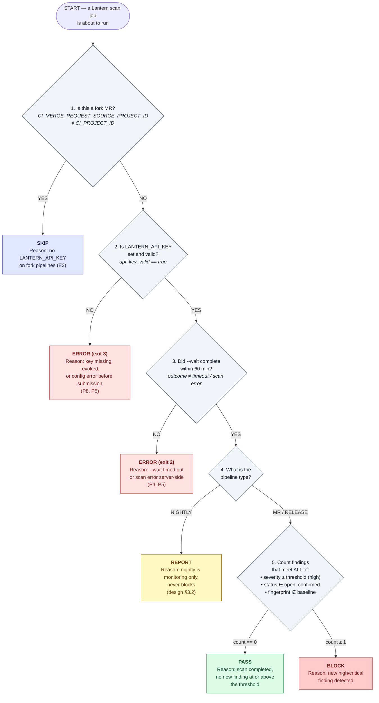

# Gate Decision Table — Lantern × Kestrel Pay

**Prepared by:** Pre-Sales Engineer, Lantern — 2026-10-19  
**Applies to:** All pipeline types in `pipeline_revised.gitlab-ci.yml`

---

## Table of Contents

1. [Gate Labels](#1-gate-labels)
2. [Decision Flowchart](#2-decision-flowchart)
3. [Decision Table](#3-decision-table)
4. [Finding Count Rules](#4-finding-count-rules)
5. [Batch 1 Results — S01 to S06](#5-batch-1-results--s01-to-s06)

---

## 1. Gate Labels

Every scan outcome resolves to exactly **one** of these five labels:

| Label | Meaning | Pipeline continues? |
|---|---|---|
| `pass` | Scan completed — zero counted findings at or above threshold | ✅ Yes |
| `block` | Scan completed — at least one counted finding at or above threshold | ❌ No |
| `report` | Findings recorded and routed to Jira — nightly only, never blocks | ✅ Yes |
| `error` | No usable result (scan error or config/auth failure) — **never treated as pass** | ❌ No |
| `skip` | Scan intentionally not run — fork MR without API key | ✅ Yes |

> **Critical rule:** Exit codes 2 and 3 always produce `error`. They never produce `pass`, `block`, or `report`.

---

## 2. Decision Flowchart

The flowchart below shows the exact order in which conditions are evaluated. Apply each check top to bottom and stop at the first match.



---

## 3. Decision Table

Apply rows top to bottom. Stop at the **first row that matches** all conditions.

| Row | Pipeline type | Fork | Key valid | Exit code | Counted findings | Label | Reason |
|---|---|---|---|---|---|---|---|
| 1 | any | ✅ yes | — | — | — | `skip` | Fork MR — key not injected by GitLab (E3) |
| 2 | any | no | ❌ no / invalid | 3 | — | `error` | Auth/config error before submission (P5, P8) |
| 3 | any | no | ✅ yes | 2 | — | `error` | Scan error or --wait timeout after 60 min (P4, P5) |
| 4 | nightly | no | ✅ yes | 0 or 1 | any | `report` | Nightly is monitoring only — never blocks |
| 5 | release / MR | no | ✅ yes | 0 | 0 | `pass` | Scan completed, no new finding at or above threshold |
| 6 | release / MR | no | ✅ yes | 1 | ≥ 1 | `block` | New high/critical finding — pipeline must stop |

> **Note on row 4:** Even if nightly produces exit 1 (findings detected), the label is `report` — not `block`. The pipeline job itself exits 0 after logging the findings (handled in the revised pipeline script).

> **Note on row 6:** Only findings with status `open` or `confirmed`, severity ≥ threshold, and fingerprint NOT in the baseline are counted. All other findings are excluded before applying this row.

---

## 4. Finding Count Rules

Before applying the decision table, compute the **counted findings** for the scan result.

A finding **counts** (contributes to exit code 1) only if **all three** conditions are true:

```
  ✅  severity  >=  --fail-on threshold  (high or critical)
  ✅  status    ==  "open"  OR  "confirmed"
  ✅  fingerprint  NOT present in the baseline scan
```

A finding is **excluded** (does not count) if **any** of these apply:

```
  ❌  status  ==  "false_positive"          → never counts regardless of severity
  ❌  status  ==  "risk_accepted"           → never counts regardless of severity
  ❌  status  ==  "fixed"                   → never counts regardless of severity
  ❌  fingerprint  IN  baseline fingerprints → excluded_by_baseline, never counts
  ❌  severity  <  threshold                → below the fail-on level, ignored
```

> **Ref:** P6 (statuses that count), P7 (baseline exclusion mechanism)

---

## 5. Batch 1 Results — S01 to S06

---

### S01 — Release 4.12.0: Android gate

**Context:** Release pipeline, tag `v4.12.0` on `release/4.12`, not a fork.  
Key: set and valid. Baseline: `rel-4.11-android` → fingerprints `[fp-and-01, fp-and-02]`.

**Command my pipeline runs:**
```bash
lantern scan mobile \
  --file android/app/build/outputs/bundle/release/app-release.aab \
  --plan mobile-full \
  --baseline rel-4.11-android \
  --wait \
  --fail-on high
```

**Finding analysis:**

| Finding | Severity | Status | Fingerprint | In baseline? | Counts? |
|---|---|---|---|---|---|
| F-101 — Exported activity without permission check | high | open | `fp-and-01` | ✅ yes | ❌ excluded by baseline (P7) |
| F-102 — Cleartext traffic allowed for analytics domain | medium | open | `fp-and-31` | ❌ no | ❌ below threshold (medium < high) |
| F-103 — Verbose logging of request identifiers | low | open | `fp-and-32` | ❌ no | ❌ below threshold (low < high) |

**Counted findings: 0**

**Exit code: 0** — scan completed, zero findings at or above threshold (P5)

**Label: `pass`**

**Reason:** Scan completed cleanly. The only high finding (F-101) is excluded by the baseline — its fingerprint `fp-and-01` is in `rel-4.11-android`. Remaining findings are below the high threshold. No new high or critical detected. Release gate passed; `publish` job unlocked.

---

### S02 — Release 4.12.0: iOS gate

**Context:** Release pipeline, tag `v4.12.0` on `release/4.12`, not a fork, runner `macos`.  
Key: set and valid. Baseline: `rel-4.11-ios` → fingerprints `[fp-ios-01]`.  
iOS signing: `app_store` → DAST skipped automatically, static analysis only (P1).

**Command my pipeline runs:**
```bash
lantern scan mobile \
  --file ios/build/Kestrel-appstore.ipa \
  --plan mobile-full \
  --baseline rel-4.11-ios \
  --wait \
  --fail-on high
```

**Finding analysis:**

| Finding | Severity | Status | Fingerprint | In baseline? | Counts? |
|---|---|---|---|---|---|
| F-201 — Payment provider secret embedded in binary | critical | open | `fp-ios-40` | ❌ no | ✅ **counts** — new critical, open, above threshold |
| F-202 — Keychain item accessible after first unlock | high | open | `fp-ios-01` | ✅ yes | ❌ excluded by baseline (P7) |

**Counted findings: 1** (F-201)

**Exit code: 1** — scan completed, 1 counted finding at or above threshold (P5)

**Label: `block`**

**Reason:** New critical finding F-201 ("Payment provider secret embedded in binary") is open, not in the baseline, and at severity critical ≥ high threshold. Release gate failed; `publish` job locked. Must be remediated or manually approved by Imane before release proceeds (E4).

---

### S03 — Nightly: Android release bundle

**Context:** Nightly scheduled pipeline on `main`, not a fork, runner `saas-linux`.  
Key: set and valid. Baseline: `rel-4.11-android` → fingerprints `[fp-and-01, fp-and-02]`.

**Command my pipeline runs:**
```bash
lantern scan mobile \
  --file android/app/build/outputs/bundle/release/app-release.aab \
  --plan mobile-full \
  --wait \
  --fail-on high
```

> Note: nightly does not use `--baseline` in the scan command — findings are not filtered for reporting purposes. However, the exit-code handler in the revised pipeline downgrades exit 1 to exit 0 with a log message, so the pipeline continues.

**Finding analysis:**

| Finding | Severity | Status | Fingerprint | In baseline? | Counts toward exit 1? |
|---|---|---|---|---|---|
| F-301 — WebView JavaScript bridge exposed to remote content | high | open | `fp-and-50` | ❌ no | ✅ yes (exit 1 fired) |
| F-302 — Backup allowed for app data | medium | confirmed | `fp-and-02` | ✅ yes | ❌ below threshold AND in baseline |

**Counted findings: 1** (F-301) → CLI exits 1

**Exit code: 1** — findings at threshold detected. Pipeline handler downgrades to exit 0, logs findings. (P5, design §3.2)

**Label: `report`**

**Reason:** Nightly pipeline — exit 1 is downgraded to report. New high finding F-301 recorded in Lantern dashboard and routed to Jira KPAY. Pipeline continues. No blocking occurs on nightly by design.

---

### S04 — Fork MR from external contributor

**Context:** Merge request from fork `contrib/web-sdk-fix → main`. Fork = true.  
Key: `LANTERN_API_KEY` **absent** — GitLab does not inject protected variables into fork pipelines (E3).

**Command my pipeline runs:** None — job is skipped by `rules` condition.

```yaml
# Rule in revised pipeline:
- if: '$CI_PIPELINE_SOURCE == "merge_request_event"
       && $CI_MERGE_REQUEST_SOURCE_PROJECT_ID != $CI_PROJECT_ID'
  when: never
```

**Counted findings: N/A**

**Exit code: N/A**

**Label: `skip`**

**Reason:** Fork MR — `LANTERN_API_KEY` not available in this pipeline context (E3). Scan job skipped intentionally. The MR pipeline continues without a security scan. Coverage resumes on the nightly scan once the MR is merged to `main`.

---

### S05 — Nightly: web and API scan of staging

**Context:** Nightly scheduled pipeline on `main`, runner `staging-net`.  
Key: set but **`api_key_valid: false`** — the value from 2026-10-16 has been revoked (P8).

**Command my pipeline runs:**
```bash
lantern scan web \
  --target https://staging.kestrel.test \
  --auth staging-ci-token \
  --openapi api/openapi.yaml \
  --wait
```

**What happens:** The CLI attempts to authenticate with the API key from the environment variable. The key is invalid (revoked). The CLI detects this **before submitting** the scan and exits immediately.

**Counted findings: N/A** — scan never submitted

**Exit code: 3** — authentication error detected before submission (P5, P8)

**Label: `error`**

**Reason:** `LANTERN_API_KEY` present in the environment but revoked — CLI exits 3 before scan submission (P8). This is the stale key from 2026-10-16 that was hardcoded in the draft pipeline. Action A1/A2 (revoke + regenerate key) must be completed before this job can run. Additional blocker: Lantern egress IPs not yet allowlisted for staging (E5, action A6).

---

### S06 — Release 4.12.1 hotfix: Android gate after triage

**Context:** Release pipeline, tag `v4.12.1` on `release/4.12`, not a fork.  
Key: set and valid. Baseline: `rel-4.11-android` → fingerprints `[fp-and-01, fp-and-02, fp-and-03]`.

**Command my pipeline runs:**
```bash
lantern scan mobile \
  --file android/app/build/outputs/bundle/release/app-release.aab \
  --plan mobile-full \
  --baseline rel-4.11-android \
  --wait \
  --fail-on high
```

**Finding analysis:**

| Finding | Severity | Status | Fingerprint | In baseline? | Counts? | Reason |
|---|---|---|---|---|---|---|
| F-601 — SQL injection in local cache query | critical | false_positive | `fp-and-60` | ❌ no | ❌ | Status `false_positive` never counts (P6) |
| F-602 — Certificate pinning missing for status endpoint | high | risk_accepted | `fp-and-61` | ❌ no | ❌ | Status `risk_accepted` never counts (P6) |
| F-603 — Weak random used for client nonce | high | confirmed | `fp-and-03` | ✅ yes | ❌ | Fingerprint in baseline — excluded (P7) |
| F-604 — Screenshot not blocked on card screen | medium | confirmed | `fp-and-62` | ❌ no | ❌ | Below threshold (medium < high) |
| F-605 — Debuggable flag in release build | high | fixed | `fp-and-63` | ❌ no | ❌ | Status `fixed` never counts (P6) |

**Counted findings: 0**

**Exit code: 0** — scan completed, zero counted findings (P5)

**Label: `pass`**

**Reason:** All findings are excluded. F-601 is a false positive, F-602 is risk-accepted, F-603 is in the baseline, F-604 is below threshold, F-605 is fixed. Zero new high or critical findings count. Release gate passed; `publish` job unlocked.

---

## Batch 1 Summary

| Scenario | Pipeline | Exit code | Counted findings | Label |
|---|---|---|---|---|
| S01 — Release Android 4.12.0 | release | 0 | 0 (F-101 in baseline) | `pass` |
| S02 — Release iOS 4.12.0 | release | 1 | 1 (F-201 new critical) | `block` |
| S03 — Nightly Android | nightly | 1 → 0 | 1 (F-301 new high, downgraded) | `report` |
| S04 — Fork MR | merge_request | N/A | N/A | `skip` |
| S05 — Nightly web | nightly | 3 | N/A (key revoked) | `error` |
| S06 — Release Android 4.12.1 hotfix | release | 0 | 0 (all excluded) | `pass` |
