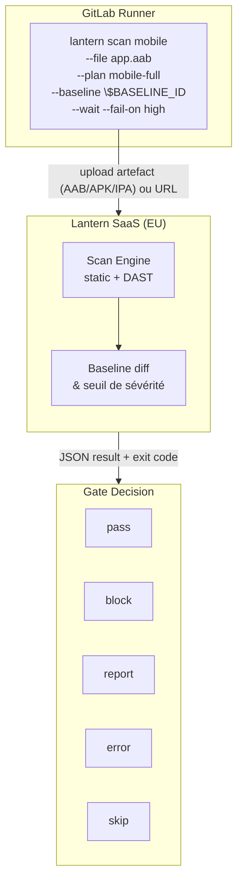
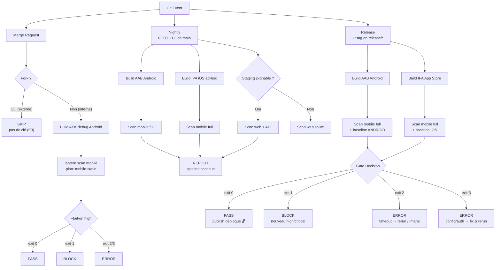
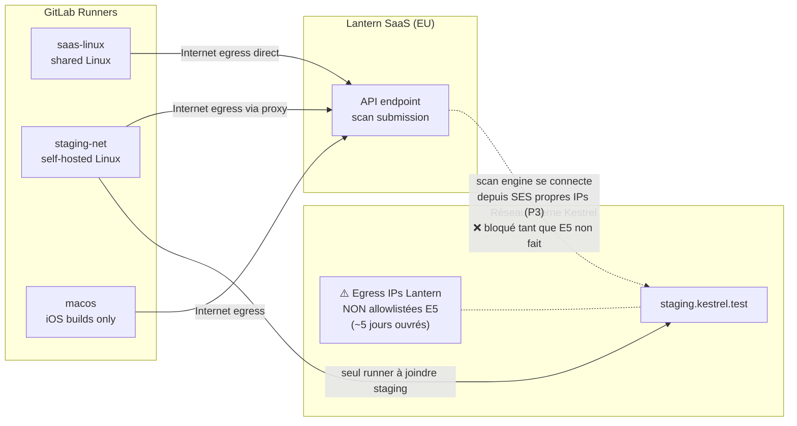
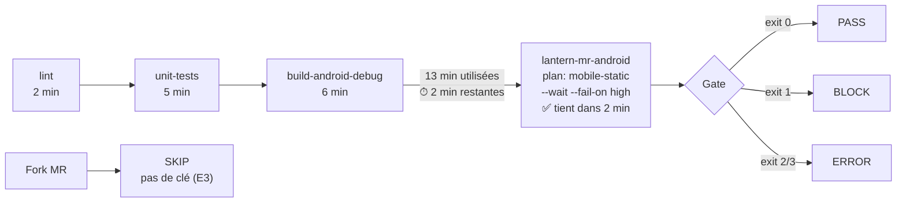
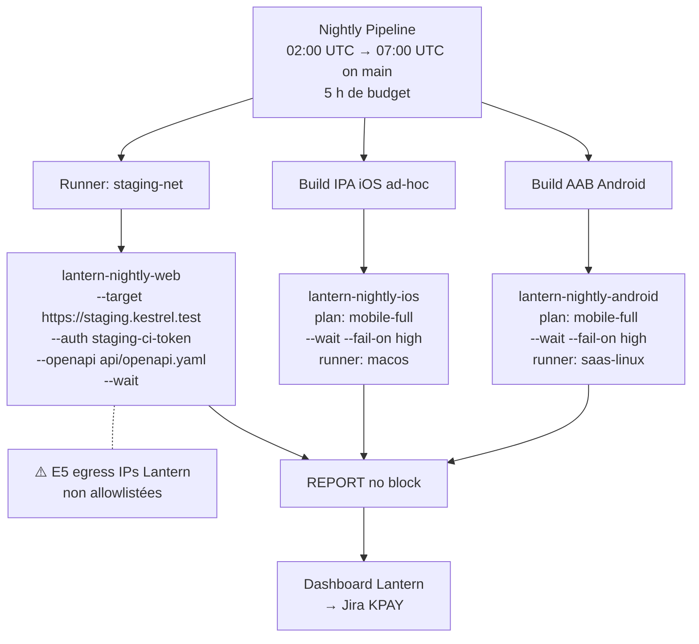
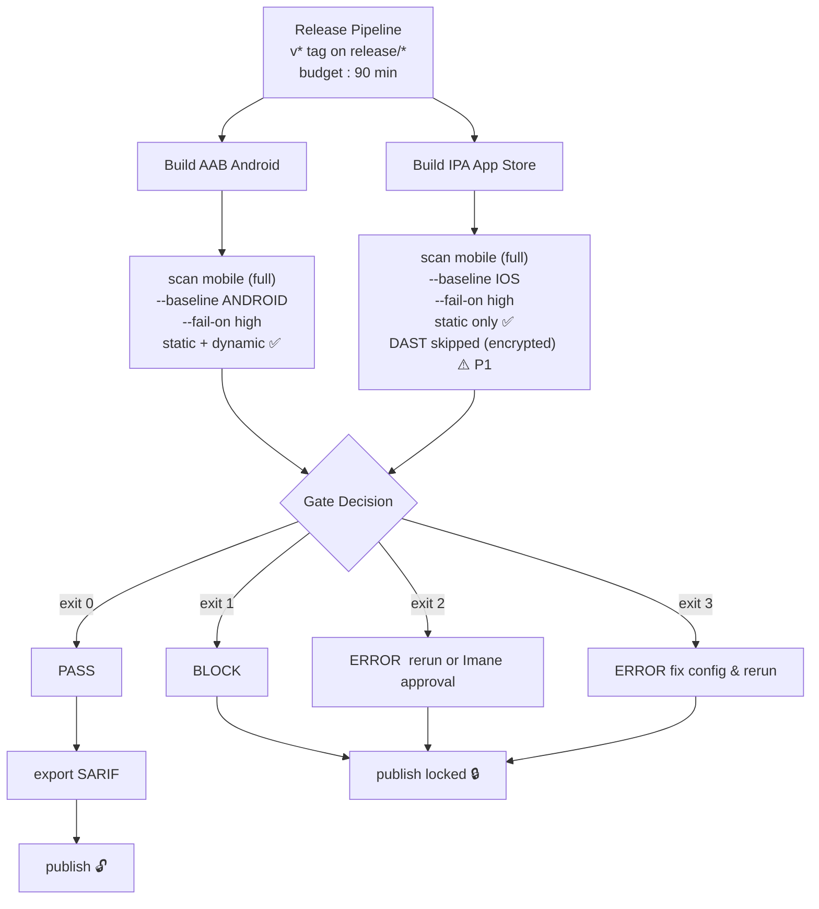

<div align="center">
  
</div>


# Lantern × Kestrel Pay  CI/CD Integration Design

| Field | Details |
|---|---|
| **Document type** | Pre-Sales Integration Design |
| **Prepared by** | Pre-Sales Engineer, Lantern |
| **Prospect** | Kestrel Pay (fictional) |
| **Trial period** | 2026-10-19 → 2026-11-02 (EU tenant) |
| **Contacts** | Rafa (Platform Lead), Imane (Security Lead), Lina (Release Manager) |
| **Status** | Draft  for trial review |

---

## Table of Contents

1. [Executive Summary](#1-executive-summary)
2. [Architecture Overview](#2-architecture-overview)
3. [Scan Coverage by Pipeline](#3-scan-coverage-by-pipeline)
4. [Secrets Handling](#4-secrets-handling)
5. [Baseline Lifecycle](#5-baseline-lifecycle)
6. [Exit Code Policy](#6-exit-code-policy)
7. [Prospect Requests R1–R8](#7-prospect-requests-r1r8)
8. [Dependencies & Action Items](#8-dependencies--action-items)

---

## 1. Executive Summary

Kestrel Pay operates a GitLab monorepo with Android, iOS, web, and API components. This document defines how Lantern's security scanning integrates into each pipeline type  merge request, nightly, and release  while respecting Kestrel's time budgets, secrets policy, and release gate requirements.

**Key design decisions at a glance:**

- 🔒 **Release gate** blocks on new high/critical findings only, using baseline comparison
- ⚡ **MR gate** uses static-only scan to fit within the 2-minute remaining budget
- 📊 **Nightly pipeline** runs full scans (static + dynamic) and reports without blocking
- 🚫 **Fork MRs** skip scanning  no API key is available by design (GitLab protected variables)
- ❌ Exit codes `2` and `3` are always treated as `error`  never as a pass

---

## 2. Architecture Overview

### 2.1 How Lantern Works in a Pipeline

The Lantern CLI runs inside a GitLab runner as part of a normal pipeline job. It does **not** perform the scan locally on the runner machine. Instead, it packages the binary file (APK, AAB, IPA) or the target URL and sends it to the Lantern SaaS platform hosted in the EU region. The SaaS engine then runs the actual static and/or dynamic analysis, compares results against the provided baseline scan, applies the severity threshold, and returns a JSON result object along with an exit code. The runner receives that exit code and the pipeline decides whether to pass, block, or flag an error.

A critical consequence of this architecture: **the runner only needs internet access to reach Lantern**, but for web/API scans, **Lantern's own scanners need to reach the web target directly** from their published egress IP ranges. This is why scanning `staging.kestrel.test` requires a firewall allowlist entry  the runner submitting the scan is not the machine doing the scanning.




---

### 2.2 Pipeline Types and Their Role

Kestrel's CI/CD has three distinct pipeline types, each with a different security role. **Merge request** pipelines are fast gates: they catch new high/critical findings before code is merged, using static analysis only because the time budget is too tight for dynamic scans. **Nightly** pipelines are deep monitoring runs: they execute full static and dynamic scans every night on `main`, recording findings without blocking anything, so the team has continuous visibility. **Release** pipelines are hard gates: they run full scans with baseline comparison and will block the `publish` job if any new high or critical finding is detected that was not present in the last accepted release.

Fork merge requests from external contributors are a special case. GitLab does not inject protected variables into fork pipelines as a security measure, so the API key is simply absent and the scan job is skipped rather than failing with a confusing auth error.



---

### 2.3 Runner and Network Topology

Kestrel operates three runners. `saas-linux` is a shared GitLab runner with direct internet access  it handles Android builds and most security scans. `staging-net` is a self-hosted runner sitting inside the internal network; it is the only runner that can reach `staging.kestrel.test`, and it also has internet egress through a proxy so it can reach the Lantern SaaS API. `macos` is dedicated to iOS builds.

The critical blocker for the web/API scan is that Lantern's scan engine connects **from its own cloud infrastructure** to the target URL  not from the runner. Even though `staging-net` can submit the scan job, Lantern's published egress IP ranges must be added to the staging firewall allowlist before the scan can actually reach the application. This request takes approximately 5 business days and has not yet been filed (E5).



---

## 3. Scan Coverage by Pipeline

### 3.1 Merge Request Pipeline

By the time the Android debug build finishes, the MR pipeline has already consumed 13 of its 15-minute budget (lint 2 min + unit tests 5 min + build 6 min), leaving only 2 minutes for security scanning. A `mobile-full` scan takes 20–45 minutes (P9)  using it with `--wait` would cause every MR to time out. The solution is `mobile-static`, which performs static analysis only and completes within the budget. Dynamic analysis (DAST) is deferred to the nightly pipeline which has a 5-hour window.

For fork MRs, GitLab's protected variable policy prevents the `LANTERN_API_KEY` from being injected (E3). The scan job is skipped using a `rules` condition rather than letting it fail with exit code 3.

| Field | Value |
|---|---|
| Artifact | `android/app/build/outputs/apk/debug/app-debug.apk` |
| Plan | `mobile-static` |
| Blocks pipeline | Yes  on new high/critical |
| Fork behavior | `skip`  key not injected (E3) |

```bash
lantern scan mobile \
  --file android/app/build/outputs/apk/debug/app-debug.apk \
  --plan mobile-static \
  --wait \
  --fail-on high
```



---

### 3.2 Nightly Pipeline

The nightly pipeline runs at 02:00 UTC on `main` and has until 07:00 UTC  a 5-hour window. This allows running `mobile-full` scans (up to 45 min per target) and the web/API DAST (up to 90 min) in parallel without time pressure. None of these scans block the pipeline  findings are recorded in the Lantern dashboard and routed to Jira KPAY, but the nightly build is never stopped. This gives the team daily visibility into the security posture of `main` without disrupting the development flow.

Two important constraints apply to the web scan. First, it must run on the `staging-net` runner since staging is on the internal network. Second, it must authenticate using `staging-ci-token` (bearer token for the `ci-scanner` service account)  the `staging-qa-user` profile uses `qa-auto` which has had MFA enforced since 2026-10-01 (E6), and Lantern's recorded login cannot complete MFA challenges (P2).

| Job | Artifact / Target | Plan | Auth profile | Runner | Blocks |
|---|---|---|---|---|---|
| `lantern-nightly-android` | `app-release.aab` | `mobile-full` |  | `saas-linux` | No  report |
| `lantern-nightly-ios` | `Kestrel-adhoc.ipa` | `mobile-full` |  | `macos` | No  report |
| `lantern-nightly-web` | `https://staging.kestrel.test` | DAST + OpenAPI | `staging-ci-token` | `staging-net` | No  report |



---

### 3.3 Release Pipeline

A release pipeline is triggered when Rafa creates a `v*` tag on a `release/*` branch. Both Android and iOS scans run, each comparing results against their respective baseline scan from the last accepted release. Only findings whose fingerprint does **not** appear in the baseline are counted  this is how Kestrel's "block only on new" policy (E4, R4) is enforced.

The Android AAB gets full static + dynamic analysis. The App Store IPA gets static analysis only  Apple's encryption prevents Lantern from running the dynamic engine (P1). DAST is automatically skipped and reported as such; it is not a scan failure.

If both scans exit 0, the gate passes, a SARIF report is exported for audit purposes (R7), and the manual `publish` job is unlocked for Lina. If either scan exits 1 (new high/critical finding), 2 (timeout), or 3 (config error), the `publish` job remains locked and the release is blocked until remediated or manually approved by Imane (E4).

| Job | Artifact | Plan | Baseline | Blocks |
|---|---|---|---|---|
| `lantern-release-android` | `app-release.aab` | `mobile-full` | `$LANTERN_BASELINE_ANDROID` | Yes |
| `lantern-release-ios` | `Kestrel-appstore.ipa` | `mobile-full` (static only) | `$LANTERN_BASELINE_IOS` | Yes |

```bash
# Android
lantern scan mobile \
  --file android/app/build/outputs/bundle/release/app-release.aab \
  --plan mobile-full \
  --baseline $LANTERN_BASELINE_ANDROID \
  --wait \
  --fail-on high

# iOS  DAST skipped automatically for App Store IPA (P1)
lantern scan mobile \
  --file ios/build/Kestrel-appstore.ipa \
  --plan mobile-full \
  --baseline $LANTERN_BASELINE_IOS \
  --wait \
  --fail-on high

# SARIF export after gate passes (R7)
lantern export \
  --scan-id $LANTERN_SCAN_ID \
  --format sarif \
  --out lantern-release.sarif
```



---

## 4. Secrets Handling

### 4.1 The Problem with the Draft Pipeline

The current draft pipeline stores the Lantern API key as a hardcoded YAML variable. This means the key is visible to anyone with repository read access, is logged in CI job output, and is committed to Git history. This violates Kestrel's own security policy (E3) and must be remediated before the pipeline runs for the first time. The key `lk_live_7f3c9d1e2b4a4c8e9f0a1b2c3d4e5f60` must be **revoked immediately** from the Lantern dashboard (P8) and a new key generated.

```yaml
# ❌ CURRENT DRAFT  CRITICAL ISSUE  key exposed in repository
variables:
  LANTERN_API_KEY: "lk_live_7f3c9d1e2b4a4c8e9f0a1b2c3d4e5f60"
```

### 4.2 The Correct Approach

The corrected pipeline contains no secrets in YAML. All three sensitive values are stored as GitLab CI/CD variables marked as both **masked** (redacted from job logs) and **protected** (only injected into pipelines running on protected refs). The runner receives the key automatically at runtime without it ever touching the repository.

```
GitLab Project Settings → CI/CD → Variables

  LANTERN_API_KEY           [masked] [protected] ✅
  LANTERN_BASELINE_ANDROID  [masked] [protected] ✅
  LANTERN_BASELINE_IOS      [masked] [protected] ✅
```

### 4.3 Variable Availability by Pipeline Context

Protected variables are deliberately withheld from fork pipelines by GitLab. This is a security feature  an external contributor's fork could otherwise exfiltrate secrets by printing them in a job script. The pipeline must detect this condition and skip the scan job cleanly rather than failing with a confusing exit code 3 auth error.

```
┌─────────────────────────────┬────────────────────────────────────────┐
│ Pipeline context            │ LANTERN_API_KEY available?             │
├─────────────────────────────┼────────────────────────────────────────┤
│ main branch (scheduled)     │ ✅ Yes  protected schedule            │
│ release/* branch            │ ✅ Yes  protected branch              │
│ v* tag                      │ ✅ Yes  protected tag                 │
│ Internal MR branch          │ ✅ Yes  internal protected branch     │
│ Fork MR (external contrib.) │ ❌ No   scan is skipped (E3)          │
└─────────────────────────────┴────────────────────────────────────────┘
```

---

## 5. Baseline Lifecycle

### 5.1 What a Baseline Does

A baseline is a completed Lantern scan ID used as a reference point. When `--baseline <scan_id>` is passed to the CLI, it fetches the findings from that reference scan and excludes any finding whose **fingerprint** already appears there. These excluded findings are listed as `excluded_by_baseline` in the result and never count toward exit code 1. This mechanism directly implements Kestrel's release policy: block only on findings that are **new** since the last accepted release, not on findings that are already tracked and managed in Jira KPAY (E4, R4).

If the baseline scan ID does not exist in the tenant  for example because it was entered incorrectly  the CLI exits with code 3 before submitting the scan. This is treated as `error` and blocks the release until corrected.

### 5.2 The Baseline Update Process

After each release, Lina is responsible for two steps. First, she reviews the accepted Lantern scan results in the dashboard and records the scan IDs in Jira KPAY alongside the release notes. Second, she updates the two GitLab CI variables to point to the new scan IDs. From that point forward, the next release gate will diff against the freshly accepted baseline and only surface genuinely new risk.

If this step is skipped, the next release will compare against a stale baseline. Depending on the fingerprints involved, it may either block on findings that were already accepted, or fail to surface new ones if fingerprints overlap unexpectedly. Updating the baseline variables after every release is a mandatory item in the release runbook.

```
  Release N completes
         │
         ▼
  Lina reviews scan results in Lantern dashboard
         │
         ▼
  Lina records scan IDs in Jira KPAY release notes
         │
         ├── LANTERN_BASELINE_ANDROID  ←  new scan ID (e.g. rel-4.N-android)
         └── LANTERN_BASELINE_IOS      ←  new scan ID (e.g. rel-4.N-ios)
                    │
                    ▼
         Lina updates both protected CI variables in GitLab
                    │
                    ▼
         Next release gate diffs against the new baseline
         → only findings NEW since release N will count toward a block
```

### 5.3 Current Baseline Values

| Variable | Current value | Set after |
|---|---|---|
| `LANTERN_BASELINE_ANDROID` | `rel-4.11-android` | Release 4.11  2026-09-30 |
| `LANTERN_BASELINE_IOS` | `rel-4.11-ios` | Release 4.11  2026-09-30 |

---

## 6. Exit Code Policy

### 6.1 What the Exit Codes Mean

The CLI exits with one of four codes after every invocation. Exit code `0` means the scan completed and no finding at or above the threshold was counted  or the scan was submitted without `--wait`. Exit code `1` means the scan completed and at least one finding with status `open` or `confirmed`, at or above the threshold, and not excluded by the baseline, was detected. Exit code `2` means the scan encountered a server-side error, or the `--wait` timeout of 60 minutes expired before the scan finished  the scan may still be running server-side and its results will appear in the dashboard. Exit code `3` means a configuration or authentication error was detected **before** the scan was even submitted  a missing key, a revoked key, a missing file, an unknown plan, a baseline ID that does not exist in the tenant, or invalid arguments.

The distinction between 2 and 3 matters operationally: exit 3 is always a configuration problem that someone must fix before retrying; exit 2 may be transient (a slow scan on a large binary) and a rerun or a manual approval by Imane may be appropriate (E4).

```
  exit 0  ──► scan completed, nothing counted at or above threshold
              OR submitted only (no --wait)
              OR no --fail-on given

  exit 1  ──► scan completed, ≥1 finding counted
              (open/confirmed, at/above threshold, not in baseline)

  exit 2  ──► scan error  OR  --wait timed out after 60 min
              (scan may still be running server-side)

  exit 3  ──► config/auth error BEFORE submission
              (bad key, missing file, unknown plan, baseline not found)
```

### 6.2 Gate Label by Pipeline and Exit Code

Each combination of pipeline type and exit code produces exactly one gate label. `PASS` means the gate completed cleanly and the pipeline continues. `BLOCK` means a qualifying security finding was detected and the pipeline stops. `REPORT` means the result is recorded and routed to Jira but the pipeline is not stopped  nightly is a monitoring run, not a gate. `ERROR` means the scan produced no usable result and the pipeline fails with a signal that is clearly technical rather than security-related. `SKIP` means no scan ran at all, which is the correct outcome for fork MRs.

Exit codes 2 and 3 are always `ERROR`  they never produce a green pipeline and they never trigger a security block. Using `|| true` on a Lantern scan command, as in the original draft, defeats this guarantee entirely (R8).

```
┌────────────────┬──────────┬──────────┬──────────┬──────────┐
│ Pipeline       │ Exit 0   │ Exit 1   │ Exit 2   │ Exit 3   │
├────────────────┼──────────┼──────────┼──────────┼──────────┤
│ Release        │  PASS    │  BLOCK   │  ERROR   │  ERROR   │
│ Nightly        │  REPORT  │  REPORT  │  ERROR   │  ERROR   │
│ MR (internal)  │  PASS    │  BLOCK   │  ERROR   │  ERROR   │
│ MR (fork)      │  SKIP    │  SKIP    │  SKIP    │  SKIP    │
└────────────────┴──────────┴──────────┴──────────┴──────────┘

  ⚠️  Exit codes 2 and 3 → always ERROR, never PASS
  ⚠️  || true must never appear on a Lantern scan command
```

### 6.3 Which Findings Are Counted

A scan can return many findings but zero *counted* findings, producing exit code 0 even when the report is non-empty. This is expected and correct. Only findings that meet all three conditions simultaneously are counted: severity at or above the threshold, status `open` or `confirmed`, and fingerprint not present in the baseline. Findings with any other status  `false_positive`, `risk_accepted`, or `fixed`  are never counted, regardless of severity. Findings present in the baseline are excluded regardless of their status.

This means a `PASS` on a release with known vulnerabilities is not a mistake. Those vulnerabilities are tracked in Jira KPAY and the team has made a conscious decision about each one. The gate is designed to surface new, unreviewed risk  not to re-block on risk that has already been evaluated.

```
  A finding COUNTS toward exit 1 only if ALL three conditions are true:
  ┌────────────────────────────────────────────────────────────┐
  │  ✅  severity  >=  threshold (e.g. high or critical)       │
  │  ✅  status    ==  "open"  OR  "confirmed"                 │
  │  ✅  fingerprint  NOT in baseline scan                     │
  └────────────────────────────────────────────────────────────┘

  A finding is EXCLUDED (does not count) if ANY of these apply:
  ┌────────────────────────────────────────────────────────────┐
  │  ❌  status  ==  "false_positive"                          │
  │  ❌  status  ==  "risk_accepted"                           │
  │  ❌  status  ==  "fixed"                                   │
  │  ❌  fingerprint IS in baseline  (excluded_by_baseline)    │
  │  ❌  severity  <  threshold                                │
  └────────────────────────────────────────────────────────────┘
```

---

## 7. Prospect Requests R1–R8

### Summary

| # | Request | Status | Short answer |
|---|---|---|---|
| R1 | Block MR on high/critical (mobile) | ⚠️ Partly supported | Time budget forces static-only on MR; full gate enforced at release |
| R2 | SAST of `web/` and `api/` source code | ❌ Not supported | Lantern performs DAST only  no source-code analysis for web/API |
| R3 | Full GraphQL testing before signing | ❌ Not supported | Generic HTTP only; no GraphQL-specific engine, no roadmap date |
| R4 | Release blocks only on new findings | ✅ Supported | `--baseline` flag excludes known findings from the count |
| R5 | Full DAST of the App Store IPA | ❌ Not supported | App Store IPA is encrypted  static analysis only |
| R6 | Automatic ServiceNow tickets | ❌ Not supported | No ServiceNow integration; Jira Cloud sync is available |
| R7 | SARIF artifact per release | ✅ Supported | `lantern export --format sarif` stored as pipeline artifact |
| R8 | No silent pass or silent fail | ✅ Supported | Exit 2/3 = error always; `|| true` removed from all scan jobs |

---

### Detailed Responses

#### R1  Block MR on high/critical (mobile)
> *"Every merge request that introduces a high or critical finding should be blocked before merge, including the mobile apps."*

**⚠️ Partly supported.**

The MR pipeline has only 2 minutes of remaining budget after lint, unit tests, and the debug build (E2). A `mobile-full` scan takes 20–45 minutes (P9) and cannot run with `--wait` in that window. The integration uses `mobile-static` on MR, which catches the majority of high and critical findings through static analysis and fits within the budget. Full dynamic coverage runs nightly on `main` and is enforced as a hard gate on every release. Any finding that static analysis misses at the MR stage will be caught before code reaches production.

---

#### R2  SAST of `web/` and `api/` source code
> *"Lantern should also scan the source code in `web/` and `api/` on each merge request, the same way our linters do."*

**❌ Not supported.**

Lantern performs DAST on web and API targets  it tests running applications, not source code (P2). There is no source-code analysis capability for web or API repositories in the product.

**Workable alternative:** Add a dedicated SAST tool alongside Lantern in the MR pipeline  GitLab's built-in SAST, Semgrep, or SonarQube. These run on source code, integrate natively with GitLab merge requests, and are complementary to Lantern's dynamic coverage.

---

#### R3  GraphQL testing before signing
> *"We launch `/graphql` in November. Please confirm Lantern tests GraphQL properly before we sign."*

**❌ Not supported.**

Lantern scans a GraphQL endpoint as generic HTTP traffic only. There is no GraphQL-specific introspection, mutation fuzzing, or schema-aware testing (P2). No roadmap date has been supplied and none can be committed (P11).

**Workable alternative:** Evaluate GraphQL-specific DAST tools such as Escape or Inigo as a complement for the `/graphql` endpoint once it ships in November. Lantern can continue to cover the REST API via OpenAPI import in the meantime.

---

#### R4  Release blocks only on new findings
> *"Releases must block only on new high or critical findings. Known ones are already tracked in Jira."*

**✅ Supported.**

The `--baseline <scan_id>` flag (P7) compares the current scan against a reference scan. Findings whose fingerprint already appears in the baseline are listed as `excluded_by_baseline` and never count toward exit code 1. The release gate passes `$LANTERN_BASELINE_ANDROID` and `$LANTERN_BASELINE_IOS`, maintained by Lina after each release (see §5).

---

#### R5  Full DAST of the App Store IPA
> *"I want full dynamic testing of the exact iOS build we submit to the App Store."*

**❌ Not supported.**

App Store IPAs are encrypted by Apple. Lantern cannot instrument them for dynamic analysis and performs static analysis only  DAST is automatically skipped and reported as such in the scan result (P1).

**Workable alternative:** The nightly pipeline scans the ad-hoc signed IPA from the same branch with `mobile-full` (static + dynamic). The codebase, logic, and compiled code are identical  only the distribution signing differs. Nightly DAST results on the ad-hoc IPA provide the dynamic coverage Imane is looking for, one build step removed from the App Store artifact.

---

#### R6  Automatic ServiceNow tickets
> *"My security operations team works in ServiceNow. Findings should create ServiceNow tickets automatically."*

**❌ Not supported.**

Lantern has no ServiceNow integration. The roadmap lists it as "exploring"  no committed date exists and none can be promised (P10, P11).

**Workable alternative:** Lantern's Jira Cloud integration provides two-way status sync  findings open Jira tickets in KPAY automatically, and status changes in Lantern sync back to Jira. The security operations team can mirror critical Jira issues to ServiceNow using Jira's native ServiceNow connector or an automation rule. SARIF exports (R7) are also available for any custom routing pipeline.

---

#### R7  SARIF artifact per release
> *"Keep a SARIF file for every release in the pipeline artifacts so auditors can see what was checked."*

**✅ Supported.**

After the release gate passes, `lantern export` downloads the full SARIF 2.1.0 report for each scan (P10). Both the Android and iOS scan results are exported and stored as GitLab pipeline artifacts with `expire_in: 1 year` for audit retention. The artifact is attached to the release pipeline and accessible directly from the GitLab UI.

---

#### R8  No silent pass or silent fail
> *"If the scanner breaks, I want to know, but it must not quietly turn the pipeline green or red for the wrong reason."*

**✅ Supported.**

The corrected pipeline removes all `|| true` constructs from Lantern scan commands. Exit codes 2 and 3 cause the job to fail explicitly  they never produce a green pipeline and they never trigger a spurious security block. Each outcome has a distinct label and a defined remediation path. A reviewer seeing a red pipeline after a Lantern job always knows whether the cause is a security finding (exit 1) or a technical failure (exit 2 or 3), without needing to read the job log.

---

## 8. Dependencies & Action Items

The following actions must be completed by Kestrel before the integration can run correctly. None of them require Lantern involvement  they are all within Kestrel's control.

| # | Action | Owner | Deadline |
|---|---|---|---|
| A1 | Revoke the hardcoded API key from the draft pipeline | Rafa | Immediately |
| A2 | Generate a new API key from the Lantern dashboard | Rafa | Immediately |
| A3 | Add `LANTERN_API_KEY` as a masked + protected CI variable | Rafa | Before first run |
| A4 | Add `LANTERN_BASELINE_ANDROID` as a protected CI variable (`rel-4.11-android`) | Rafa | Before first release gate |
| A5 | Add `LANTERN_BASELINE_IOS` as a protected CI variable (`rel-4.11-ios`) | Rafa | Before first release gate |
| A6 | File Lantern egress IP allowlist request for `staging.kestrel.test` | Imane | Immediately (~5 business days lead time) |
| A7 | Confirm `ci-scanner` bearer token is valid and set in `staging-ci-token` auth profile | Imane | Before first nightly web scan |
| A8 | Add baseline variable update to the release runbook as a mandatory step | Lina | Before first release |
| A9 | Update `LANTERN_BASELINE_ANDROID` and `LANTERN_BASELINE_IOS` after each release | Lina | Post each release |
| A10 | Record accepted Lantern scan IDs in Jira KPAY release notes | Lina | Post each release |

---

## Appendix  Fact Reference Index

| Fact ID | Referenced in |
|---|---|
| E2 | §3.1 MR time budget constraint |
| E3 | §3.1 fork skip, §4.3 variable availability |
| E4 | §3.3 release gate policy, §5 baseline lifecycle |
| E5 | §2.3 staging network, §3.2 nightly web blocker |
| E6 | §3.2 MFA on qa-auto, use of ci-scanner token |
| E7 | §3.2 runner tag assignments |
| E8 | §3.3 SARIF artifact retention |
| P1 | §3.3 App Store IPA static-only limitation |
| P2 | §7 R2 no web SAST, R3 GraphQL generic HTTP |
| P3 | §2.1 Lantern SaaS-only, egress IPs |
| P4 | §6.1 CLI flags, --wait 60-min cap |
| P5 | §6.1 exit code definitions |
| P6 | §6.3 finding statuses that count vs. do not count |
| P7 | §5.1 baseline comparison mechanism |
| P8 | §4.1 LANTERN_API_KEY env var, revocation |
| P9 | §3.1 scan duration, MR budget conflict |
| P10 | §3.3 SARIF export, §7 R6 no ServiceNow |
| P11 | §7 R3 no roadmap promise, R6 no ServiceNow date |

---

*This document is a pre-sales design aid produced for the Lantern trial period. It does not constitute a contract, SLA, or feature commitment. All companies, people, keys, and findings referenced are fictional.*
